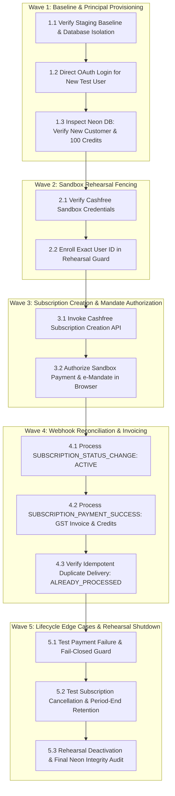

# AIRA AI 2026 — Gate 4 Cashfree Sandbox Acceptance Plan

## 1. Objective & Scope

Establish, execute, and certify the **Cashfree Recurring Subscription Sandbox Acceptance** on staging (`https://staging.virexaaiventures.com`) following the adoption of **Option 1**: isolating all Cashfree testing under a separate, legitimately authenticated test account.

This plan guarantees:
1. Complete isolation from the existing Razorpay Pro customer (`cust_9e1e096ced03407aba9db0a71f6c3253`), preserving its active Pro subscription, paid invoice `INV-2026-0001`, 7,600 credit balance, and 3 Option A `TERMINAL_FAILURE` audit records.
2. Authentic Direct OAuth user provisioning (no synthetic session forgery or database mocking).
3. Exact-ID rehearsal fencing with fail-closed security.
4. Comprehensive verification of Cashfree Subscriptions API, checkout mandate authorization, provider-signed webhooks, sequential GST invoicing, and credit fulfillment.
5. Verification of lifecycle edge cases: payment failure, retry idempotency, cancellation, and clean rehearsal shutdown.
6. Zero impact on production (`main`, `prod-release`, PR #196, and production Neon `old-sky-50952395`).

---

## 2. Infrastructure Baseline & Security Fences

| Boundary / Guard | Authoritative Specification | Verification Command / Check |
| :--- | :--- | :--- |
| **Staging Commit** | `467f554d6a2f7f9630b088fb412fadaa2b47c925` | `git rev-parse origin/staging` |
| **Vercel Project** | `prj_FZLU4vBIYSsBn28AI6drkpD5WfbH` | Vercel API / deployment inspection |
| **Target Database** | Neon Project `mute-frost-50372225`, Branch `br-snowy-bonus-b32thjlz`, Endpoint `ep-twilight-cherry-b3iz2oqv` | `scripts/staging-db-guard.ts` |
| **Production Database** | `old-sky-50952395` | **STRICT HOLD — ACCESS PROHIBITED** |
| **Staging Commercial State** | `AIRA_COMMERCIAL_BILLING_ENABLED=false` | GET `/api/billing/plans` -> `checkout_disabled` |
| **Rehearsal Guard** | `AIRA_STAGING_SANDBOX_REHEARSAL_ENABLED=true` (Temporary) | `staging-sandbox-rehearsal-guard.ts` |
| **Enrolled Principal** | Dedicated internal user ID `neon_user_<new_uuid>` | `AIRA_STAGING_REHEARSAL_ENROLLED_PRINCIPALS` |
| **Cashfree App ID** | `^TEST[a-zA-Z0-9]+$` | Rehearsal credential validation |
| **Cashfree Environment** | `CASHFREE_ENV=TEST` | Rehearsal credential validation |

---

## 3. Dependency-Ordered Execution Waves



---

## 4. Detailed Task Specifications

### Wave 1: Baseline Verification & Isolated Principal Provisioning

#### Task 1.1: Staging Baseline & Database Isolation Verification
- **Goal**: Confirm that staging is serving commit `467f554d6a2f7f9630b088fb412fadaa2b47c925`, commercial billing is disabled, and database is isolated to `ep-twilight-cherry-b3iz2oqv`.
- **Mode**: Autonomous.
- **Verification Steps**:
  1. `curl.exe -s https://staging.virexaaiventures.com/api/health` -> verify `HEALTHY`, version `2026.2.0`, `database: "REACHABLE"`.
  2. `curl.exe -s https://staging.virexaaiventures.com/api/billing/plans` -> verify `billingStatus: "checkout_disabled"`, `checkoutAvailable: false`.
  3. Verify that Razorpay Pro customer (`cust_9e1e096ced03407aba9db0a71f6c3253`) has active subscription `pur_8150add7f93743e38138b5617f727188` and 7,600 credits.
- **Gate**: PASS before proceeding.

#### Task 1.2: Legitimate Direct OAuth Authentication for Cashfree Test Account
- **Goal**: Authenticate a brand-new, distinct test account via legitimate Direct OAuth on staging to obtain an authoritative user identity.
- **Mode**: **Interactive (Operator Action required in Browser Pane)**.
- **Execution Steps**:
  1. Browser subagent (or operator) navigates to `https://staging.virexaaiventures.com`.
  2. Click "Sign in or Create Account" -> "Continue with Google" (or "Continue with GitHub").
  3. **Human Checkpoint**: Operator authenticates with a distinct test account (e.g. `aira.cashfree.test@gmail.com` or another separate test identity).
  4. OAuth callback redirects back to staging (`/api/auth/oauth/google/callback`), establishing an authentic BFF session cookie.
- **Gate**: Browser lands on authenticated dashboard; session cookie active.

#### Task 1.3: New Principal Neon Database Verification
- **Goal**: Query staging Neon database to discover and certify the newly provisioned customer identity.
- **Mode**: Autonomous.
- **Verification Steps**:
  1. Query `users` table for the new user record; extract `neon_user_<new_uuid>`.
  2. Query `billing_customers` for `principal_id = 'neon_user_<new_uuid>'`; extract `cust_<new_id>`.
  3. Query `credit_accounts` for `customer_id = 'cust_<new_id>'`; confirm `balance_credits = 100`, `lifetime_granted_credits = 100`.
  4. Query `subscriptions` for `customer_id = 'cust_<new_id>'`; confirm count is 0.
  5. Query existing Razorpay records; confirm zero mutations to `cust_9e1e096ced03407aba9db0a71f6c3253`.
- **Gate**: New user isolated with 100 welcome credits; zero existing subscriptions.

---

### Wave 2: Sandbox Credentials & Rehearsal Fence Configuration

#### Task 2.1: Verify Cashfree Sandbox Credentials Contract
- **Goal**: Ensure staging environment variables satisfy Cashfree sandbox requirements.
- **Mode**: Autonomous.
- **Verification Steps**:
  1. `CASHFREE_APP_ID`: must match `^TEST[a-zA-Z0-9]+$`. (No mock strings, no production live keys).
  2. `CASHFREE_SECRET_KEY`: non-empty valid test secret.
  3. `CASHFREE_WEBHOOK_SECRET`: non-empty valid webhook secret (or matches secret key).
  4. `CASHFREE_ENV`: strictly `'TEST'`.
- **Gate**: Credentials validated by `staging-sandbox-rehearsal-guard.ts`.

#### Task 2.2: Exact-ID Rehearsal Enrollment & Rehearsal Activation
- **Goal**: Restrict sandbox rehearsal exclusively to the new test principal while keeping public access disabled.
- **Mode**: Autonomous (requires operator configuration of Vercel env or header-based rehearsal token).
- **Execution Steps**:
  1. Set `AIRA_STAGING_REHEARSAL_ENROLLED_PRINCIPALS = 'neon_user_<new_uuid>'`.
  2. Set `AIRA_STAGING_SANDBOX_REHEARSAL_ENABLED = 'true'`.
  3. Ensure `AIRA_COMMERCIAL_BILLING_ENABLED = 'false'`.
  4. Test that un-enrolled requests to `/api/billing/checkout/subscription` return `BILLING_UNAVAILABLE` or `checkout_disabled`.
  5. Test that authenticated requests for `neon_user_<new_uuid>` pass rehearsal authorization.
- **Gate**: Rehearsal active strictly for `neon_user_<new_uuid>`; all other users blocked.

---

### Wave 3: Recurring Subscription Creation & Sandbox Mandate Authorization

#### Task 3.1: Recurring Subscription Creation via Subscriptions API
- **Goal**: Initiate a recurring subscription checkout targeting Cashfree Sandbox.
- **Mode**: Autonomous (via authenticated API session).
- **Execution Steps**:
  1. Dispatch POST `/api/billing/checkout/subscription`:
     ```json
     {
       "planTier": "pro",
       "currency": "INR",
       "gateway": "cashfree"
     }
     ```
  2. System calls Cashfree Subscriptions API: `POST https://sandbox.cashfree.com/pg/subscriptions`.
  3. System records pending subscription in `subscriptions` table:
     - `customer_id`: `cust_<new_id>`
     - `plan_id`: `pro`
     - `status`: `pending`
     - `gateway`: `cashfree`
     - `gateway_subscription_id`: `sub_cf_<id>`
     - `amount_minor_units`: `99900`
  4. Endpoint returns `{ subscriptionId: 'pur_...', authLink: 'https://sandbox.cashfree.com/...' }`.
- **Gate**: Cashfree `authLink` generated; database subscription in `pending` state.

#### Task 3.2: Sandbox Payment & Mandate Authorization
- **Goal**: Authorize the recurring e-mandate and initial cycle payment in Cashfree Sandbox.
- **Mode**: **Interactive / Browser Subagent**.
- **Execution Steps**:
  1. Navigate to Cashfree `authLink` in browser pane.
  2. In Cashfree Sandbox UI, select Test Netbanking / UPI Autopay / Test Card.
  3. Complete authorization (Simulated Success).
  4. Capture Cashfree reference IDs: `cf_subscription_id`, `cf_payment_id`.
- **Gate**: Cashfree checkout reports authorization success and triggers webhooks.

---

### Wave 4: Webhook Delivery, Exactly-Once Reconciliation & GST Invoicing

#### Task 4.1: Subscription Status Change Webhook Reconciliation
- **Goal**: Process Cashfree `SUBSCRIPTION_STATUS_CHANGE` (`ACTIVE`) webhook.
- **Mode**: Autonomous.
- **Execution Steps**:
  1. Staging receives webhook at `POST /api/billing/webhook/cashfree`.
  2. Webhook handler verifies HMAC-SHA256 signature (`x-webhook-signature` over `${timestamp}${rawBody}`).
  3. Handler extracts `subId` and transitions `subscriptions` record to `active`.
  4. Validates that status-only event does NOT generate an invoice or grant credits.
- **Gate**: Subscription `status = 'active'`; credit account balance remains 100.

#### Task 4.2: Payment Success Webhook Reconciliation & Fulfillment
- **Goal**: Process Cashfree `SUBSCRIPTION_PAYMENT_SUCCESS` webhook with exact-once fulfillment.
- **Mode**: Autonomous.
- **Execution Steps**:
  1. Staging receives `SUBSCRIPTION_PAYMENT_SUCCESS` webhook.
  2. Webhook handler verifies signature and resolves deterministic event ID.
  3. Handler verifies payment amount (₹999.00) matches Pro plan.
  4. System executes atomic transaction:
     - Generates sequential tax invoice `INV-2026-0002` (SAC 998431, Total ₹999.00, Taxable ₹846.61, GST ₹152.39).
     - Issues credit grant `grant_<id>` (amount: 7,500 credits, Pro allotment, 30-day expiration).
     - Updates `credit_accounts` balance: `100 + 7500 = 7600 credits`.
     - Records event in `payment_gateway_events` (`processed: true`).
- **Gate**: Exactly 1 invoice `INV-2026-0002` exists; credit balance is exactly 7,600.

#### Task 4.3: Webhook Idempotency & Duplicate Rejection
- **Goal**: Deliver duplicate/retry webhooks and certify duplicate rejection.
- **Mode**: Autonomous.
- **Execution Steps**:
  1. Re-send identical `SUBSCRIPTION_PAYMENT_SUCCESS` payload with same signature and headers.
  2. Verify response returns `ALREADY_PROCESSED` (HTTP 200).
  3. Confirm zero duplicate invoices generated (still exactly 1 invoice).
  4. Confirm zero duplicate credits granted (balance remains exactly 7,600).
- **Gate**: Exactly-once fulfillment mathematically verified.

---

### Wave 5: Lifecycle Edge Cases & Rehearsal Shutdown

#### Task 5.1: Payment Failure Handling & Replay Guard
- **Goal**: Verify payment failure webhook behavior and fail-closed security.
- **Mode**: Autonomous.
- **Execution Steps**:
  1. Dispatch/simulate signed `SUBSCRIPTION_PAYMENT_FAILED` webhook.
  2. Verify handler records failure in audit log without revoking active status prematurely or corrupting wallet.
  3. Verify retries of terminal failure events remain fail-closed.
- **Gate**: Audit event recorded; state uncorrupted.

#### Task 5.2: Subscription Cancellation & Period-End Retention
- **Goal**: Verify customer-initiated or provider-initiated cancellation.
- **Mode**: Autonomous.
- **Execution Steps**:
  1. Post cancellation request to `/api/billing/subscriptions/cancel`.
  2. System calls Cashfree Subscriptions cancel endpoint.
  3. Process `SUBSCRIPTION_STATUS_CHANGE` (`CANCELLED`).
  4. Verify subscription transitions to `cancelled` and sets `cancelled_at`.
  5. Verify that granted 7,500 credits remain retained in wallet for the remainder of the 30-day billing period.
  6. Verify prohibited reactivation (`INVALID_STATE_TRANSITION`).
- **Gate**: Cancellation cleanly recorded; credit balance remains accessible until expiry.

#### Task 5.3: Rehearsal Shutdown & Full Baseline Integrity Audit
- **Goal**: Cleanly shut down rehearsal mode and verify zero cross-account or production bleed.
- **Mode**: Autonomous.
- **Execution Steps**:
  1. Set `AIRA_STAGING_SANDBOX_REHEARSAL_ENABLED = 'false'`.
  2. Remove `AIRA_STAGING_REHEARSAL_ENROLLED_PRINCIPALS`.
  3. Query `https://staging.virexaaiventures.com/api/billing/plans` to verify `"billingStatus": "checkout_disabled"`.
  4. Execute full Neon integrity query across all customers:
     - Cashfree test customer: 1 subscription, 1 invoice (`INV-2026-0002`), 7,600 credits.
     - Razorpay Pro customer (`cust_9e1e096ced03407aba9db0a71f6c3253`): 1 active subscription, 1 invoice (`INV-2026-0001`), 7,600 credits, 3 Option A `TERMINAL_FAILURE` events intact.
     - Production Neon (`old-sky-50952395`): completely untouched.
- **Gate**: Rehearsal shutdown verified; all financial invariants intact.

---

## 5. Division of Responsibility: Autonomous vs. Interactive

| Execution Step | Role | Execution Mechanism | Reason |
| :--- | :--- | :--- | :--- |
| **Staging Baseline & Isolation Inspection** | **Autonomous** | Orchestrator (curl & SQL scripts) | Read-only inspection of live deployment and DB |
| **New Test Account OAuth Login** | **Interactive** | Human Operator in Browser Pane | Google/GitHub authentication is protected by anti-bot controls; automated agents cannot solve CAPTCHAs or forge tokens |
| **New Principal Discovery & Verification** | **Autonomous** | Orchestrator (Neon SQL query) | Discovers internal user ID and verifies customer/wallet tables |
| **Rehearsal Guard Enrollment** | **Autonomous / Config** | Orchestrator / Vercel Environment | Setting exact internal user ID in rehearsal allowlist |
| **Subscription Checkout API Call** | **Autonomous** | Orchestrator (Node API client) | Calling `/api/billing/checkout/subscription` |
| **Sandbox Payment / Mandate Authorization** | **Semi-Autonomous** | Browser Subagent / Operator | Browser subagent can click test-mode payment in Cashfree sandbox; operator required if OTP/challenge appears |
| **Webhook Delivery & Signature Verification** | **Autonomous** | Cashfree Webhook Dispatcher / Test Client | Direct HTTPS POST of signed webhooks to staging |
| **Invoice, Credit & Ledger Verification** | **Autonomous** | Orchestrator (Neon SQL query) | Direct verification of PostgreSQL tables |
| **Cancellation & Idempotency Testing** | **Autonomous** | Orchestrator (Node test scripts) | Direct API calls & duplicate webhook dispatches |
| **Rehearsal Shutdown & Certification** | **Autonomous** | Orchestrator | Flipping rehearsal flag to false and auditing invariants |

---

## 6. Rollback & Emergency Stop Procedures

1. **Emergency Stop (Kill Switch)**:
   - If any unexpected event or cross-account leakage occurs, set `AIRA_STAGING_SANDBOX_REHEARSAL_ENABLED = 'false'`.
   - The staging billing engine immediately reverts to fail-closed `checkout_disabled`.
2. **Database Rollback Target**:
   - Staging Neon branch: `br-snowy-bonus-b32thjlz`.
   - A fresh point-in-time branch can be spawned from Neon timeline prior to rehearsal if physical isolation is desired.
   - However, since Option 1 operates on a distinct customer row (`cust_<new_id>`), no rows belonging to other customers are ever touched by Cashfree DML operations.
3. **Production Safe Harbor**:
   - Production branch `prod-release` and PR #196 are on strict hold.
   - Zero production database mutations can occur because credentials point exclusively to `ep-twilight-cherry-b3iz2oqv`.
