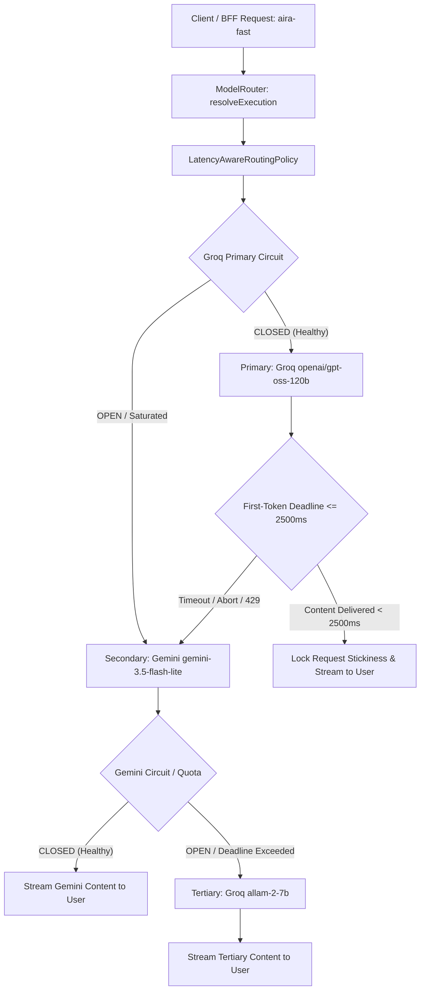

# AIRA AI 2026 — P1.6 Latency-Aware Provider Routing Policy

## 1. Objective & Policy Architecture

AIRA Fast (`aira-fast`) must never remain pinned to an upstream provider experiencing tail-latency spikes, capacity degradation, or rate limits. The P1.6 routing architecture replaces static single-provider pinning with an evidence-based, deterministic **Latency-Aware Routing Policy** integrated with a stateful **Circuit Breaker** and **First-Token Deadline Engine**.



---

## 2. Catalog & Empirical Model Selection

The policy enforces an explicit quality floor (>= 7.5 / 10) and reliability threshold (>= 99%) across supported models:

| Provider | Model ID | Status | P50 TTFT | Reliability | Technical Quality | Role & Governance |
| :--- | :--- | :---: | :---: | :---: | :---: | :--- |
| **Groq** | `openai/gpt-oss-120b` | **ALLOWED** | 447 ms | 100% | 9.5 / 10 | **Primary Fast Model**: Superior coding, factual QA, and high contextual precision. |
| **Gemini** | `gemini-3.5-flash-lite` | **ALLOWED** | 493 ms | 100% | 9.8 / 10 | **Certified Secondary Fast Model**: Independent Google infrastructure quota, 440-650ms native streaming. |
| **Groq** | `allam-2-7b` | **ALLOWED** | 240 ms | 100% | 7.2 / 10 | **Tertiary Intra-Groq Fallback**: Ultra-fast TTFT, zero empty responses, high fallback resilience. |
| **Gemini** | `gemini-3.5-flash` | **STANDBY** | 1,942 ms | 100% | 9.7 / 10 | **Deprioritized for Fast**: Thinking tokens (~240 tokens) introduce ~1,900ms delay. |
| **Gemini** | `gemini-3.8-flash` | **REJECTED** | N/A | 0.0% | 0.0 / 10 | **Blacklisted**: Upstream 503 high-demand capacity exhaustion. |
| **Gemini** | `gemini-2.5-flash` | **REJECTED** | N/A | 0.0% | 0.0 / 10 | **Blacklisted**: Upstream 404 retired model. |
| **Groq** | `qwen/qwen3.8-27b` | **REJECTED** | 133 ms | 56.3% | 8.5 / 10 | **Blacklisted**: Groq on-demand tier enforces a strict 1,000 OTPM quota, causing 429 rate limit outages. |
| **Groq** | `openai/gpt-oss-20b` | **REJECTED** | 359 ms | 56.3% | 3.0 / 10 | **Blacklisted**: 43.7% empty responses observed on live Groq endpoint (silent failure bug). |
| **Cerebras** | `llama3.1-8b` | **STANDBY** | 280 ms | Unconfigured | 8.0 / 10 | Configured in policy; activates automatically when `CEREBRAS_API_KEY` is provided. |
| **NVIDIA** | `nvidia/nemotron-3-super-120b-a12b` | **EXCLUDED** | 3,100 ms | 100% | 9.8 / 10 | **Strictly Reserved for AIRA Deep**; never used as Fast fallback (Section 12). |


---

## 3. Circuit Breaker Specification (Section 7)

Each provider and model pair is monitored via a rolling sliding-window telemetry record (`ProviderHealthTracker`):

- **Sliding Window:** 50 requests
- **Circuit States:**
  - `CLOSED`: Normal operation. Provider latency and error rates are within acceptable thresholds.
  - `OPEN`: Provider has tripped safety boundaries. Routed requests bypass this provider immediately and fail over to the secondary fallback without attempting a network call.
  - `HALF_OPEN`: Cooldown period has elapsed. A single probe request is permitted to test provider recovery.
- **Trip Conditions:**
  - **Consecutive Timeouts >= 2:** Two consecutive first-token timeouts (or network timeouts) immediately open the circuit.
  - **Consecutive Rate Limits (429) >= 3:** Saturated quota immediately trips circuit to open.
  - **Error Rate >= 40% with P95 Latency >= 4,000 ms:** Sustained degradation trips the circuit.
  - **HALF_OPEN Probe Failure:** An immediate re-trip with exponential backoff cooldown (15s base -> 30s -> 60s max).
- **Flapping Prevention:**
  - Successful probe in `HALF_OPEN` resets error counters and returns the circuit to `CLOSED`.

---

## 4. First-Token Deadline & Request Stickiness (Sections 8 & 15)

### Truthful First-Token Deadline:
- For `aira-fast`, the deadline is strictly set to **2,500 ms**.
- **Crucial Rule:** Thinking tokens, lifecycle SSE events (`routing_decision`, `model_provenance`), and keepalives **DO NOT** count as content.
- If no real text content delta is emitted before the deadline:
  1. The primary request is aborted cleanly via `AbortController`.
  2. The failure is recorded in `ProviderHealthTracker`.
  3. The request transitions to the verified fallback provider/model.

### Request Stickiness:
- Fallback and hedging are permitted **ONLY before visible content begins**.
- Once the first content delta is emitted to the client, the provider and model for that completion are **strictly locked** (`stickinessLocked = true`).
- If an upstream network disconnect occurs mid-generation, the stream fails gracefully; it **never** splices tokens from another provider mid-sentence.

---

## 5. Truthful Fallback Provenance (Section 9)

Fallback is never silent. When a fallback occurs, `ResilientModelAdapter` triggers an authoritative update emitted over SSE as `model_provenance`:

```json
{
  "requestedProvider": "groq",
  "requestedModel": "openai/gpt-oss-120b",
  "executedProvider": "gemini",
  "executedModel": "gemini-3.5-flash-lite",
  "fallbackOccurred": true,
  "fallbackReason": "Primary groq:openai/gpt-oss-120b rate limit (429) / deadline (2500ms) exceeded; fell back to independent secondary gemini:gemini-3.5-flash-lite",
  "hedgedRequestUsed": false,
  "modelIdentityVerified": true,
  "executionStatus": "FALLBACK"
}
```

---

## 6. Multi-Turn Context Integrity (Section 16)

When fallback occurs, conversation history is preserved across turns without loss:
1. `Turn 1`: Context established with primary provider.
2. `Turn 2`: Primary provider lags; request times out and falls back to secondary provider.
3. `Turn 3`: Follow-up query sent. The secondary provider receives full conversation history (Turns 1 & 2) and correctly recalls previously stated context.
Verified by automated integration test `test/p1-6-multi-turn-consistency.test.ts` (100% PASS).

---

## 7. Hedged Request Experimentation (Section 10)

The engine supports speculative hedged racing (`ResilientModelAdapter.streamWithHedging`):
- Launches primary Fast provider.
- If no content arrives within `hedgeDelayMs` (default: 1,200 ms), launches alternate provider in parallel.
- Winner takes all: The first provider to emit a non-empty content token locks the stream; the slower loser is immediately aborted via `AbortSignal`.
- **Policy Recommendation:** While verified functional in unit tests (`test/p1-6-hedged-requests.test.ts`), hedging increases upstream token consumption and is kept **OFF by default** (`AIRA_ENABLE_HEDGING=false`) until multi-provider credentials (such as Cerebras or Together) are provisioned to avoid consuming Groq single-account concurrency.
