# AIRA AI 2026 — P1 Inference Baseline Benchmark Report

**Benchmark Timestamp**: 2026-10-16T18:54:17.575Z  
**Target Environment**: Canonical Production (`https://aira-ai-2026.vercel.app`)  
**Production Commit SHA**: `65b03784b9463811da532262831ebdc26820780b`  
**Sample Size**: 10 Controlled Short Conversational Prompts  
**Active Upstream Provider**: NVIDIA NIM (`https://integrate.api.nvidia.com/v1`)  
**Active Production Model**: `nvidia/nemotron-3-super-120b-a12b`

---

## 1. Executive Summary & Percentiles

| Metric | Min | P50 (Median) | P75 | P95 | Max | Mean |
|---|---|---|---|---|---|---|
| **TTFB (Time to First Byte)** | 254 ms | **279 ms** | 296 ms | 376 ms | 422 ms | 304 ms |
| **TTFT (Time to First Visible Token)** | 10186 ms | **13097 ms** | 16167 ms | 17995 ms | 38162 ms | 16259 ms |
| **Total Request Duration** | 13656 ms | **19308 ms** | 19774 ms | 25802 ms | 39467 ms | 20316 ms |

---

## 2. Latency Waterfall Breakdown

The measured median TTFT of **13097 ms (~13.1s)** decomposes into four clear bottleneck stages:

```mermaid
gantt
    title AIRA Production Normal Chat Latency Waterfall (Baseline)
    dateFormat  X
    axisFormat %s s
    section Network
    Browser to Vercel TTFB : 0, 350
    section Intent Routing
    Semantic Reasoner Model Classification (Nemotron LLM call) : 350, 7500
    section Pre-Provider Runtime
    Neon Postgres (Singapore) DB queries & Knowledge Engine : 7500, 9500
    section Upstream Inference
    NVIDIA NIM Dispatch & Connection : 9500, 11500
    Nemotron-120B Hidden Reasoning/Thinking Phase : 11500, 14500
    First Visible Content Delta Emitted : 14500, 15000
```

1. **TTFB (~350 ms)**: Fast edge routing from client to Vercel `iad1`.
2. **Intent Routing Classification (~7,100 ms)**: `ServerIntentRouter` invokes `SemanticReasoner.classifyWithModel`, which makes a synchronous, non-streaming full LLM call to Nemotron-120B to decide if the prompt is an `ANSWER` or `RESEARCH`.
3. **Database Pre-Provider Queries (~2,000 ms)**: 6+ serial network round-trips from Vercel `iad1` to Neon PostgreSQL in `ap-southeast-1` (Singapore): `saveRun`, `appendRunEvent`, `knowledgeEngine.search`, `searchRunsForPrincipal`.
4. **Upstream Inference & Reasoning Phase (~5,000 ms)**: NVIDIA NIM runs `nvidia/nemotron-3-super-120b-a12b`. The model outputs hundreds of hidden reasoning/thinking tokens (`thinking_delta`) before the first word of the actual response is emitted.

---

## 3. Individual Prompt Benchmark Results

| # | Prompt | TTFB | Routing Done | First Think | **TTFT (Visible)** | Total Time | Deltas | Status |
|---|---|---|---|---|---|---|---|---|
| 1 | "What is HTTP in one sentence?" | 376 ms | 2509 ms | 6376 ms | **11993 ms** | 14230 ms | 11 text / 23 think | 200 |
| 2 | "Say hello in one sentence." | 324 ms | 6121 ms | 9153 ms | **17995 ms** | 19359 ms | 3 text / 39 think | 200 |
| 3 | "Explain REST briefly." | 422 ms | 1242 ms | 4404 ms | **10186 ms** | 21180 ms | 52 text / 21 think | 200 |
| 4 | "What is 2 + 2?" | 279 ms | 2994 ms | 8219 ms | **12375 ms** | 13749 ms | 3 text / 18 think | 200 |
| 5 | "Define latency." | 262 ms | 1151 ms | 4253 ms | **13097 ms** | 16631 ms | 27 text / 28 think | 200 |
| 6 | "What is DNS in simple terms?" | 287 ms | 3201 ms | 6573 ms | **15480 ms** | 19774 ms | 28 text / 28 think | 200 |
| 7 | "How does a compiler work in one sentence?" | 267 ms | 1175 ms | 4545 ms | **10528 ms** | 13656 ms | 17 text / 21 think | 200 |
| 8 | "Name three primary colors." | 276 ms | 5438 ms | 8322 ms | **16167 ms** | 19308 ms | 17 text / 27 think | 200 |
| 9 | "What is JSON?" | 254 ms | 1153 ms | 4539 ms | **16602 ms** | 25802 ms | 44 text / 30 think | 200 |
| 10 | "Tell me a short one-line joke." | 296 ms | 20979 ms | 24902 ms | **38162 ms** | 39467 ms | 2 text / 52 think | 200 |

---

## 4. Key Architectural Findings

1. **Routing Inefficiency**: Plain conversational chat prompts like *"Say hello in one sentence"* or *"What is 2 + 2?"* do not hit a fast deterministic path; they fall through to an expensive model classification call on Nemotron-120B.
2. **Model Mismatch for Everyday Normal Chat**: `nvidia/nemotron-3-super-120b-a12b` is a high-latency reasoning model. It insists on deep internal reasoning even for 1-sentence answers, delaying first visible text by several seconds.
3. **Neon Database Round-trips on Critical Path**: Every step before inference saves state and events to Neon in Singapore. Each query incurs ~200-250ms of cross-continental latency.
4. **Synchronous DB Writes on Stream Chunks**: Emitting each delta awaits `saveRun` and `appendRunEvent`, creating network backpressure on the SSE stream.

---

*Baseline benchmark captured autonomously by Agency Orchestrator & Engineering Team on 2026-10-16T18:54:17.575Z.*
