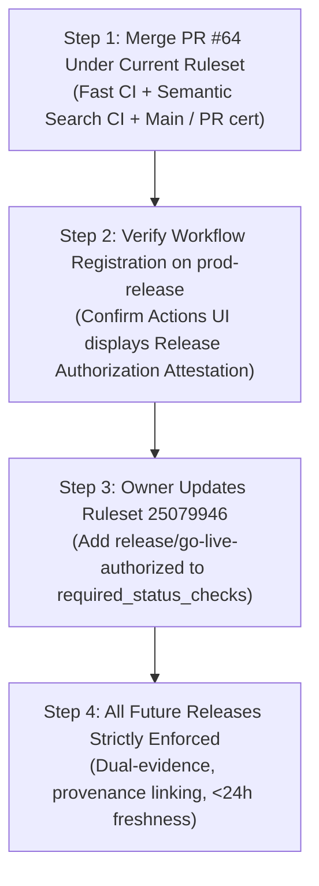

# AIRA AI 2026 — Release Authorization Staging Ruleset & Bootstrap Specification

## Purpose
This document specifies the architecture, real platform verification, safe bootstrap sequence, dual-evidence provenance validation, and active revocation mechanism for `release/go-live-authorized` on GitHub Pro Ruleset `AIRA Production Protection` (ID: `25079946`).

> [!IMPORTANT]
> Under repository release safety rules, automated agents **must not modify or mutate the live production ruleset (ID: 25079946)** without explicit owner approval.
> Automated agents must never auto-merge PR #64 or dispatch live production workflows.
> Every production-changing transition requires separate owner authorization.

---

## 1. Verified Platform Baseline & Constraints (2026-10-14)

### GitHub Repository & Ruleset
- **Default Branch**: `prod-release`
- **Active Ruleset**: `AIRA Production Protection` (ID: `25079946`)
- **Target Condition**: `refs/heads/prod-release`
- **Current Enforced Status Checks**:
  1. `Fast CI` (integration_id: `15368` - GitHub Actions)
  2. `Semantic Search CI` (integration_id: `15368` - GitHub Actions)
  3. `Main / PR certification` (integration_id: `15368` - GitHub Actions)
- **Strict Up-To-Date Policy**: `strict_required_status_checks_policy: true`
  (Enforces that PR branches must be rebased/merged with current `prod-release` before merging).
- **Deletion & Force Push**: Denied server-side.
- **Direct Push to `prod-release`**: Denied server-side (HTTP 403).

### Real GitHub Platform Evidence (Empirically Probed 2026-10-14)
1. **GitHub Actions Workflow Registration**:
   - Workflows triggered via `workflow_dispatch` **MUST exist on the repository default branch** (`prod-release`) to appear in the GitHub Actions UI and to be invocable via the REST API.
   - If a workflow file exists only on a feature branch (e.g. PR #64) and not on `prod-release`, GitHub will not permit dispatching it.
2. **`workflow_dispatch` Input Availability in GitHub REST API**:
   - Live query of `GET /repos/:owner/:repo/actions/runs` returns `inputs: undefined` on the run object.
   - GitHub Actions REST API does *not* echo dispatch inputs in the run payload.
   - Consequently, input verification and PR binding must occur inside the workflow runner, which authenticates the dispatch arguments against the GitHub Pull Request API and emits an immutable commit status referencing the exact PR and linking directly to the run ID.
3. **Commit Status Check Source Attribution & Expiration**:
   - Status checks created via `POST /repos/:owner/:repo/statuses/:sha` record `creator`, `context`, `state`, `description`, `target_url`, `created_at`, and `updated_at`.
   - **GitHub Commit Statuses Do Not Natively Expire**: GitHub rulesets have no native TTL mechanism for commit statuses. A status with `state: success` remains valid for that commit SHA until explicitly superseded by a newer status for that same context, or until a new commit is pushed to the branch.

---

## 2. Problem 1 Remediation: Safe 4-Step Bootstrap Sequence

### The Chicken-and-Egg Deadlock
If the repository owner were instructed to require `release/go-live-authorized` in ruleset `25079946` *before* PR #64 is merged:
1. `release-authorization.yml` would not yet exist on the default branch (`prod-release`).
2. The owner would be unable to trigger `Release Authorization Attestation (No Deployment)` via UI or API.
3. PR #64 could never obtain `release/go-live-authorized=success`.
4. The repository would enter a permanent, self-inflicted deadlock.

### The Phased Bootstrap Sequence
Each step below is isolated and requires separate owner decision and action:



#### Step 1: PR #64 Review & Bootstrap Merge (Separate Owner Action)
- PR #64 contains:
  * `.github/workflows/release-authorization.yml`
  * `src/security/release-authorization-validator.ts`
  * `scripts/verify-release-authorization.ts`
  * `scripts/revoke-release-authorization.ts`
  * `test/release-authorization-guard.test.ts` (31 unit tests)
  * Updated release policies and master prompt.
- Ruleset `25079946` remains in its current state (requiring only Fast CI, Semantic Search CI, Main / PR certification).
- The owner reviews PR #64, verifies all CI checks pass, and executes the merge into `prod-release`.

#### Step 2: Verify Default-Branch Registration
- Once PR #64 is merged into `prod-release`, GitHub automatically indexes `.github/workflows/release-authorization.yml`.
- The owner verifies that `Release Authorization Attestation (No Deployment)` appears under **Actions** in GitHub:
  ```bash
  gh workflow list
  ```
- The owner can optionally execute a test run against a non-production test PR to verify the runner executes and records status.

#### Step 3: Owner Activates Mandatory Status Check in Ruleset (Separate Owner Action)
- The owner updates Ruleset `25079946` to include `release/go-live-authorized` in `required_status_checks` (see Section 6 for exact payload).
- This step is executed manually by the owner via GitHub Web UI or GitHub CLI.
- No automated agent is permitted to execute this update.

#### Step 4: Strict Gate Active for All Subsequent Releases
- From this point forward, GitHub's Merge button is permanently disabled on all PRs targeting `prod-release` until:
  1. The owner manually dispatches the attestation workflow for the exact head SHA.
  2. The workflow verifies PR metadata and emits `release/go-live-authorized=success`.
  3. Pre-merge verification confirms dual evidence and fresh (<24h) status.

---

## 3. Problem 2 Remediation: Dual-Evidence & Provenance Architecture

Previous verifier implementations used permissive fallback logic (`matchingRun || matchingStatus`).
The revised architecture enforces **Authoritative Dual Evidence with Provenance Linking**:

### Verification Requirements:
1. **Authentic Workflow Run**:
   - Dispatched exclusively by repository owner (`rajpunkeshwarrajgautam-boop`).
   - Event must strictly equal `workflow_dispatch`.
   - Workflow identity must match `.github/workflows/release-authorization.yml`.
   - Status must be `completed` and conclusion must be `success`.
   - Timestamp must be within 24 hours of release verification.
2. **Authentic Commit Status**:
   - Context must strictly match `release/go-live-authorized`.
   - State must strictly equal `success`.
   - Description must bind the specific PR number (`PR #<number>`).
   - Timestamp must be within 24 hours of release verification.
3. **Cryptographic / URL Provenance Linkage**:
   - The commit status `target_url` must contain a URL to the specific GitHub Actions run:
     `https://github.com/:owner/:repo/actions/runs/:run_id`
   - The verifier extracts `:run_id` from the commit status and fetches `/actions/runs/:run_id` from the GitHub API.
   - It verifies that the status was emitted by the exact run inspected.
4. **Failure-Closed Handling**:
   - If either the workflow run or commit status is missing, verification fails with `INCOMPLETE_AUTHORIZATION_EVIDENCE`.
   - If the provenance link is missing or mismatches the run ID, verification fails with `STATUS_PROVENANCE_MISSING` or `PROVENANCE_LINK_MISMATCH`.
   - If either element is older than 24 hours, verification fails with `EXPIRED_AUTHORIZATION_ATTESTATION` or `EXPIRED_COMMIT_STATUS`.

---

## 4. Problem 3 Remediation: Freshness & Active Revocation

### Platform Reality Declaration
GitHub Commit Statuses have **no automatic expiration or TTL mechanism**. Once set to `success` on a given commit SHA, GitHub's ruleset treats that status check as satisfied indefinitely for that specific SHA.

### Enforcement Strategy
To guarantee that stale authorizations cannot be merged after 24 hours, AIRA AI 2026 implements a two-tier mechanism:

1. **Pre-Merge Verification Gate (`npm run verify:release-auth`)**:
   - Inspects `created_at` on both the commit status and workflow run.
   - If `Date.now() - created_at > 24 * 60 * 60 * 1000`, the script exits with non-zero code (`EXPIRED_COMMIT_STATUS`), blocking the release workflow.
2. **Active Revocation Script (`npm run revoke:release-auth`)**:
   - If an authorization needs to be revoked immediately (e.g. security concern, cancelled release, expired authorization window):
     ```bash
     npm run revoke:release-auth -- --sha <candidate_sha> --reason "<reason>"
     ```
   - This tool invokes GitHub's Status API to post:
     ```json
     {
       "context": "release/go-live-authorized",
       "state": "failure",
       "description": "REVOKED: <reason>"
     }
     ```
   - Because GitHub rulesets evaluate the most recent status for each context, posting `state: failure` **instantly locks GitHub's PR merge gate server-side**.
3. **Code Mutation Protection**:
   - Any new push to the PR branch creates a new commit SHA.
   - Because commit statuses are bound to a specific SHA, the new commit has no status, and the merge gate automatically re-locks.

---

## 5. Target Ruleset Configuration (For Owner Execution in Step 3)

When the repository owner is ready to execute **Step 3** of the Bootstrap Sequence:

```bash
gh api --method PUT repos/rajpunkeshwarrajgautam-boop/AIRA-AI-2026/rulesets/25079946 \
  --input - << 'EOF'
{
  "name": "AIRA Production Protection",
  "target": "branch",
  "enforcement": "active",
  "conditions": {
    "ref_name": {
      "include": ["refs/heads/prod-release"],
      "exclude": []
    }
  },
  "rules": [
    { "type": "deletion" },
    { "type": "non_fast_forward" },
    {
      "type": "pull_request",
      "parameters": {
        "required_approving_review_count": 0,
        "dismiss_stale_reviews_on_push": false,
        "required_reviewers": [],
        "require_code_owner_review": false,
        "require_last_push_approval": false,
        "required_review_thread_resolution": true,
        "require_extra_approval_for_unattributed_changes": true,
        "allowed_merge_methods": ["merge", "squash", "rebase"]
      }
    },
    {
      "type": "required_status_checks",
      "parameters": {
        "strict_required_status_checks_policy": true,
        "do_not_enforce_on_create": false,
        "required_status_checks": [
          { "context": "Fast CI" },
          { "context": "Semantic Search CI" },
          { "context": "Main / PR certification" },
          { "context": "release/go-live-authorized" }
        ]
      }
    }
  ]
}
EOF
```

---

## 6. Rollback Procedure

If `release/go-live-authorized` must be temporarily removed from required status checks:

```bash
gh api --method PUT repos/rajpunkeshwarrajgautam-boop/AIRA-AI-2026/rulesets/25079946 \
  --input - << 'EOF'
{
  "name": "AIRA Production Protection",
  "target": "branch",
  "enforcement": "active",
  "conditions": {
    "ref_name": {
      "include": ["refs/heads/prod-release"],
      "exclude": []
    }
  },
  "rules": [
    { "type": "deletion" },
    { "type": "non_fast_forward" },
    {
      "type": "pull_request",
      "parameters": {
        "required_approving_review_count": 0,
        "dismiss_stale_reviews_on_push": false,
        "required_reviewers": [],
        "require_code_owner_review": false,
        "require_last_push_approval": false,
        "required_review_thread_resolution": true,
        "require_extra_approval_for_unattributed_changes": true,
        "allowed_merge_methods": ["merge", "squash", "rebase"]
      }
    },
    {
      "type": "required_status_checks",
      "parameters": {
        "strict_required_status_checks_policy": true,
        "do_not_enforce_on_create": false,
        "required_status_checks": [
          { "context": "Fast CI" },
          { "context": "Semantic Search CI" },
          { "context": "Main / PR certification" }
        ]
      }
    }
  ]
}
EOF
```
