# AIRA Adaptive Studio: Backend & Durable-Worker Certification Plan

**Document Version:** 1.0.0  
**Status:** DRAFT / STAGING READINESS SPECIFICATION  
**Scope:** Authoritative Backend Contracts, Staging Environment, and Live Acceptance Suites  
**Target Infrastructure:** Cloudflare Workers, Durable Objects, Neon PostgreSQL (Migration 030), and Standby Specialist Worker  

---

## 1. Executive Summary

Adaptive Studio is currently verified on the client layer using an opt-in feature flag (`VITE_ADAPTIVE_STUDIO_PREVIEW`), mocked Server-Sent Events (SSE), and isolated local sandboxing.

To achieve **full production certification**, Adaptive Studio must be connected to and verified against AIRA's authoritative backend infrastructure:
1. Live SSE streaming from the AI Engine / Durable Objects.
2. Durable multi-agent workflow orchestration via specialist worker containers.
3. Persistent Human-In-The-Loop (HITL) tool approvals in PostgreSQL.
4. Multi-file artifact bundling and workspace synchronization in Neon.
5. Strict cross-tenant and cross-principal authorization isolation.

This document establishes the exact contract specifications, environment isolation boundaries, dependency requirements (PR #127 and PR #137), and automated acceptance harnesses.

---

## 2. Adaptive Studio Authoritative Backend Contracts

```mermaid
sequenceDiagram
    autonumber
    participant Browser as Adaptive Studio Client
    participant API as AIRA API / Edge Gateway
    participant DO as Durable Object / Session Worker
    participant DB as Neon PostgreSQL (Migration 030)
    participant Worker as Specialist Worker Container

    Browser->>API: POST /api/chat (prompt, mode="agent", workspaceId)
    API->>DO: Bind session & initialize execution run
    DO->>DB: Verify principal_workspace_authorities (Migration 030)
    DO-->>Browser: SSE Connection Established (text/event-stream)
    
    rect rgb(30, 40, 60)
        Note over Browser,Worker: Multi-Agent Execution Loop
        DO-->>Browser: sse: step_start { taskId, role: "backend-architect" }
        DO->>Worker: Dispatch subtask with token & budget
        Worker-->>DO: Tool execution request { tool: "run_query" }
        DO-->>Browser: sse: approval_required { approvalId, risk: "HIGH" }
        Browser->>API: POST /api/approvals/:id/decision (ALLOW_ONCE)
        API->>DB: Atomic CAS approval resolution & outbox emission
        DB-->>DO: Approval confirmed
        DO->>Worker: Resume execution
        Worker-->>DO: Subtask output + artifact stream
        DO-->>Browser: sse: artifact_snapshot { delta, version: 1 }
        DO-->>Browser: sse: step_complete { taskId, durationMs }
    end

    DO-->>Browser: sse: run_complete { finalStatus: "SUCCESS" }
```



### 2.1 Authenticated Chat & SSE Streaming (`/api/chat` & `/api/agent/stream`)
- **Protocol:** HTTP/1.1 or HTTP/2 Server-Sent Events (`text/event-stream`).
- **Authorization:** `Authorization: Bearer <session-token>` (validated against BFF session cookie or HttpOnly bearer token).
- **Mandatory Lifecycle Events:**
  - `step_start`: Emitted when an agent step begins execution (`{ stepId, taskId, agentRole, timestamp }`).
  - `step_complete`: Emitted when a step completes (`{ stepId, taskId, durationMs, outputSummary }`).
  - `tool_call_start`: Emitted when an agent invokes a tool (`{ toolCallId, toolName, argumentsPreview }`).
  - `tool_call_complete`: Emitted when tool returns (`{ toolCallId, durationMs, status: "ok" | "error" }`).
  - `artifact_snapshot`: Emitted during real-time code/artifact generation (`{ artifactId, delta, version }`).
  - `artifact_complete`: Emitted when an artifact stream closes and passes security linting (`{ artifactId, version, sha256 }`).
  - `approval_required`: Emitted when a tool requires HITL authorization (`{ approvalId, actionType, riskLevel, requestedScope }`).
  - `approval_resolved`: Emitted when approval is granted or rejected (`{ approvalId, resolution: "approved" | "rejected" }`).
  - `run_complete`: Emitted when the entire agent mission terminates (`{ runId, totalDurationMs, tokensUsed }`).
  - `run_failed`: Emitted if the run encounters an unrecoverable failure (`{ runId, errorCode, errorMessage }`).

### 2.2 Human-In-The-Loop (HITL) Approval Endpoints (`/api/approvals/:id/decision`)
- **Method:** `POST`
- **Request Body Contract:**
  ```json
  {
    "decision": "approve" | "reject",
    "resolutionMode": "ALLOW_ONCE" | "ALLOW_REUSABLE_SESSION",
    "principalId": "usr_canonical_uuid",
    "justification": "Approved via Adaptive Studio HITL Bridge"
  }
  ```
- **Authoritative Invariants:**
  1. *ALLOW_ONCE Consumption:* Approval grants expire immediately after single execution. Replay attempts fail closed with HTTP 409 Conflict.
  2. *Identity Binding:* The resolving principal must match the authorized owner in `principal_workspace_authorities`.
  3. *No Automatic Approval:* Repair prompts or agent proposals must NEVER self-approve without explicit user interaction.

### 2.3 Multi-File Workspace Synchronization (`/api/workspaces/:id/sync`)
- **Method:** `POST`
- **Request Body Contract:**
  ```json
  {
    "projectId": "prj_canonical_uuid",
    "manifestVersion": "1.0.0",
    "files": [
      { "path": "src/App.tsx", "sha256": "...", "sizeBytes": 1024 },
      { "path": "assets/logo.svg", "sha256": "...", "sizeBytes": 512 }
    ]
  }
  ```
- **Authoritative Invariants:**
  1. Normalized paths only (reject Windows reserved names `CON`, `PRN`, `AUX`, `NUL`, directory traversals `..`, and hidden dot-files).
  2. Quotas: Total workspace size ≤ 50MB, file count ≤ 500 files per project.

### 2.4 Cancellation & Session Revocation (`/api/runs/:id/cancel`)
- **Method:** `POST`
- **Behavior:**
  - Client cancellation dispatches an abort signal to the Durable Object.
  - Active worker lease is fenced and revoked in PostgreSQL within 1000ms.
  - No subsequent worker events or delayed callbacks may be delivered to the client stream.

---

## 3. Dependency Mapping: PR #127 & PR #137

Adaptive Studio's full backend certification is strictly dependent on infrastructure introduced by **PR #127** and **PR #137**:

| Adaptive Studio Capability | Required Backend Infrastructure | Blocking Dependency | Current Status |
| :--- | :--- | :--- | :--- |
| **Agent Execution Graph (DAG)** | Durable multi-agent workflow execution engine and step scheduler | **PR #127** | DRAFT / Blocked |
| **Workspace Authority & Multi-File Sync** | `principal_workspace_authorities` table (Migration 030) | **PR #127** | DRAFT / Blocked |
| **Persistent HITL Approvals** | ApprovalKernel, outbox table, and atomic CAS resolution | **PR #127** | DRAFT / Blocked |
| **Crash Recovery & Fencing** | Worker lease takeover, fencing tokens, and heartbeat loop | **PR #127** | DRAFT / Blocked |
| **Specialist Dispatch (High Compute)** | Standby AMD64 specialist worker container (`aira-specialist-worker`) | **PR #137** | DRAFT / Blocked |
| **Sandboxed Code Execution** | Isolated browser execution bridge / ephemeral runner | Internal Sandbox | Present in Frontend / Preview |

> [!IMPORTANT]
> **Strict Isolation Rule:** No Neon database migrations, worker activations, or PR merges can occur until PR #127 and PR #137 are formally reviewed, attested, and authorized by the repository owner.

---

## 4. Production-Equivalent Acceptance Plan (Isolated Staging)

To certify the backend without touching production infrastructure, verification must execute within an **explicitly isolated staging environment**:

### 4.1 Staging Environment Boundaries
- **API Target:** `https://staging-api.aira.internal` (Isolated Cloudflare Worker deployment).
- **Database Target:** Disposable Neon staging branch (e.g., `ep-staging-adaptive-studio-cert`). Must never point to production Neon pool.
- **TLS Configuration:** Strict TLSv1.3 validation with certificate pinning (`verify-full` mode).
- **Principals:** Two test users created exclusively for verification:
  - `principal_alpha@staging.aira.internal` (Tenant Alpha)
  - `principal_beta@staging.aira.internal` (Tenant Beta)

### 4.2 Automated Acceptance Suites & Test Matrix

```
1. Authenticated Streaming Suite
   ├── 1.1 Establish SSE stream with valid Bearer token -> HTTP 200 text/event-stream
   ├── 1.2 Receive valid sequence: step_start -> tool_call_start -> tool_call_complete -> step_complete
   └── 1.3 Verify unauthenticated or expired token fails closed with HTTP 401

2. HITL Approval & Tool Gateway Suite
   ├── 2.1 Trigger high-risk tool dispatch -> SSE emits approval_required
   ├── 2.2 Client posts approve -> outbox records ALLOW_ONCE -> tool executes
   ├── 2.3 Attempt duplicate approval submission -> HTTP 409 Conflict (CAS rejection)
   └── 2.4 Client posts reject -> tool cancelled -> agent proceeds to alternative branch

3. Cross-Principal Isolation Suite
   ├── 3.1 Principal Alpha creates multi-file artifact project in Workspace Alpha
   ├── 3.2 Principal Beta requests GET /api/workspaces/WorkspaceAlpha/files -> HTTP 403 Forbidden
   ├── 3.3 Principal Beta attempts SSE subscription to Principal Alpha's run -> HTTP 403
   └── 3.4 Verify zero data, artifact, or log leakage across tenant boundaries

4. Cancellation & Crash Recovery Suite
   ├── 4.1 Client triggers Cancel mid-execution -> worker stops within 1000ms
   ├── 4.2 Simulate worker network disconnection -> heartbeat fail-closed lease fencing
   └── 4.3 Reconnect after crash -> outbox replays accurate terminal status without duplicate work
```

### 4.3 Certification Verdict Criteria
- **PASS:** All 4 staging acceptance suites pass against live isolated staging infrastructure with 0 errors, 0 lease race conditions, and 0 security policy rejections.
- **BLOCKED:** If disposable PostgreSQL migration fails, staging worker is unreachable, or cross-tenant data leaks, the certification halts immediately.

Simulated or mocked test runs must NEVER be represented as live backend certification.
