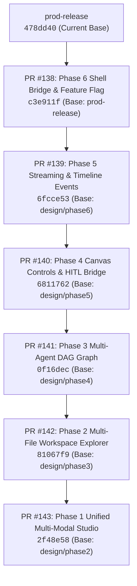
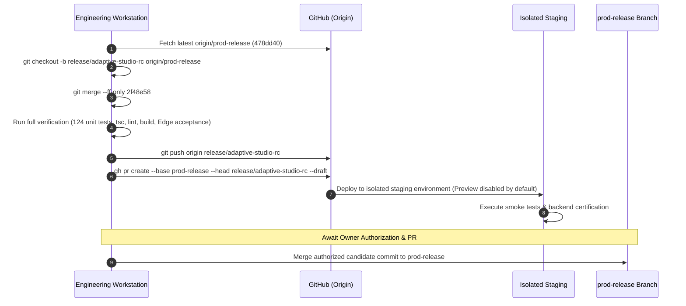

# AIRA Adaptive Studio: Final Stacked PR Integration Strategy & Runbook

**Document Version:** 1.0.0  
**Status:** DRAFT / PRE-RELEASE READINESS  
**Target Release Branch:** `prod-release`  
**Current `prod-release` HEAD:** [`478dd40d4000216c386d32e89422f2e5da1d0208`](https://github.com/rajpunkeshwarrajgautam-boop/AIRA-AI-2026/commit/478dd40d4000216c386d32e89422f2e5da1d0208)  
**Final Integration Candidate HEAD:** [`2f48e583c48529f7cf7eb4cb4be5cb0a22a362e6`](https://github.com/rajpunkeshwarrajgautam-boop/AIRA-AI-2026/commit/2f48e583c48529f7cf7eb4cb4be5cb0a22a362e6)  

---

## 1. Executive Summary

This plan defines the exact integration methodology for incorporating the seven phases of the AIRA Adaptive Studio redesign into `prod-release`.

The frontend design implementation across **Phases 7 through 1** is 100% complete, verified, and isolated across stacked Draft PRs #138 through #143. Empirically, the entire stack forms a direct linear progression starting from the tip of `prod-release` (`478dd40`). A fast-forward merge dry run demonstrates **zero conflicts, zero file collisions, and 100% clean application across all 60 affected files**.

However, because the PRs are currently stacked against successive design branches, merging them requires a rigorous strategy that accounts for GitHub's squash-merge base-shifting mechanics to avoid orphaned commits, false conflicts, or branch divergence.

---

## 2. Exact Dependency Chain & Stack Inventory

The redesign stack comprises 12 linear commits organized into 6 stacked GitHub Draft Pull Requests:



### Detailed PR Stack Metadata

| Step | PR | Branch | Base Branch | Exact HEAD SHA | Scope & Deliverable |
| :--- | :--- | :--- | :--- | :--- | :--- |
| **0** | **Base** | `prod-release` | — | `478dd40d4000216c386d32e89422f2e5da1d0208` | Account menu fix (#126) |
| **1** | **#138** | `design/adaptive-studio-phase6` | `prod-release` | `c3e911f8c6895949f658c49c716d2768833f8a01` | Opt-in shell bridge & `VITE_ADAPTIVE_STUDIO_PREVIEW` flag |
| **2** | **#139** | `design/adaptive-studio-phase5` | `design/adaptive-studio-phase6` | `6fcce53a9d4358c2ea477d1caa4628f7e5b98c68` | Streaming artifact reconciler, agent SSE timeline, repair drafts |
| **3** | **#140** | `design/adaptive-studio-phase4` | `design/adaptive-studio-phase5` | `6811762c877eb1b064612c49d92eb207b7225448` | Device viewports, zoom engine, carousel, HITL approval bridge |
| **4** | **#141** | `design/adaptive-studio-phase3` | `design/adaptive-studio-phase4` | `0f16dec599044bc322da64b294443289b61c2bb9` | Multi-agent execution DAG, wave scheduler, tool telemetry |
| **5** | **#142** | `design/adaptive-studio-phase2` | `design/adaptive-studio-phase3` | `81067f9e83fb9dfe8deebe93d5287e13274611b1` | Multi-file artifact bundling, workspace file tree, ZIP exporter |
| **6** | **#143** | `design/adaptive-studio-phase1` | `design/adaptive-studio-phase2` | `2f48e583c48529f7cf7eb4cb4be5cb0a22a362e6` | Unified Studio, multi-modal asset previews, mobile accessibility |

---

## 3. Merge Mechanics & Rebase Hazard Analysis

### The Squash-Merge Base Shift Hazard

If GitHub's standard "Squash and Merge" button is clicked on PR #138, GitHub will create a **brand-new squashed commit** `S138` on `prod-release`.

1. The intermediate commit IDs (`21e325f`, `c3e911f`) on `design/adaptive-studio-phase6` are **not** present on `prod-release`.
2. PR #139 (`design/adaptive-studio-phase5`) was branched from `c3e911f`. If PR #139 is then retargeted to `prod-release`, GitHub's three-way merge algorithm compares PR #139 against the common ancestor `478dd40`, replaying the Phase 6 changes that already exist inside `S138`.
3. This creates **spurious conflicts or duplicated commit histories** for all downstream PRs (#139 through #143).

### Permitted Integration Strategies

To eliminate merge hazard while preserving release traceability, we evaluate two safe paths:

#### **Recommended Strategy A: Coordinated Release Candidate PR (Atomic Integration)**
- **How it works:** Create a release candidate branch `release/adaptive-studio-integrated-rc` branched from `origin/prod-release`. Merge or fast-forward `design/adaptive-studio-phase1` (`2f48e58`) onto it. Run all verification gates. Open a single, cleanly documented PR targeting `prod-release`.
- **Advantages:**
  - Exactly one atomic merge commit or squash onto `prod-release`.
  - Zero risk of intermediate broken states on `prod-release`.
  - PRs #138–#143 remain archived in GitHub history as immutable reference records.
  - Complete rollback is trivial: reverting one merge commit completely removes Adaptive Studio.

#### **Strategy B: Strict Sequential Squash-and-Rebase Cascade**
- **How it works:** If each phase must be merged as an independent PR onto `prod-release`:
  1. Squash-merge PR #138 to `prod-release` -> produces commit `S138`.
  2. Rebase `design/adaptive-studio-phase5` onto `S138`:
     ```powershell
     git rebase --onto S138 c3e911f8c6895949f658c49c716d2768833f8a01 design/adaptive-studio-phase5
     git push origin design/adaptive-studio-phase5 --force-with-lease
     ```
  3. Retarget PR #139 base to `prod-release`. Squash-merge PR #139 -> produces commit `S139`.
  4. Repeat sequentially for PR #140, PR #141, PR #142, and PR #143.
- **Drawbacks:** Requires 5 sequential rebase-pushes and manual PR base updates in GitHub, introducing coordination overhead and timing windows.

---

## 4. Step-by-Step Integration Runbook (Strategy A Execution)



### Pre-Integration Verification Checklist
Before authorizing the integration candidate to be merged into `prod-release`:

1. [ ] **Git Working Tree Clean:** Zero uncommitted changes.
2. [ ] **Head SHA Exact Match:** Candidate head is exactly `2f48e583c48529f7cf7eb4cb4be5cb0a22a362e6`.
3. [ ] **Unit Tests:** 55/55 Adaptive Studio tests and 69/69 core repository tests pass.
4. [ ] **Typecheck:** `npm run typecheck:client` (`tsc -b`) exits 0 with 0 errors.
5. [ ] **Linter:** `npm run lint` (`oxlint`) exits 0 with 0 errors.
6. [ ] **Production Build (Default-Off):** `npm run build` exits 0.
7. [ ] **Production Build (Flag-Enabled):** `VITE_ADAPTIVE_STUDIO_PREVIEW=true npm run build` exits 0.
8. [ ] **Microsoft Edge Acceptance:** All viewports (`1600x1000`, `768x1024`, `390x844`, `320x700`, default-off) PASS with 0 horizontal overflow and un-obscured controls.
9. [ ] **PR #127 & PR #137 Gate Check:** PR #127 (Migration 030, durable runtime) and PR #137 (standby worker) dependencies are clearly recorded and remain untouched.
