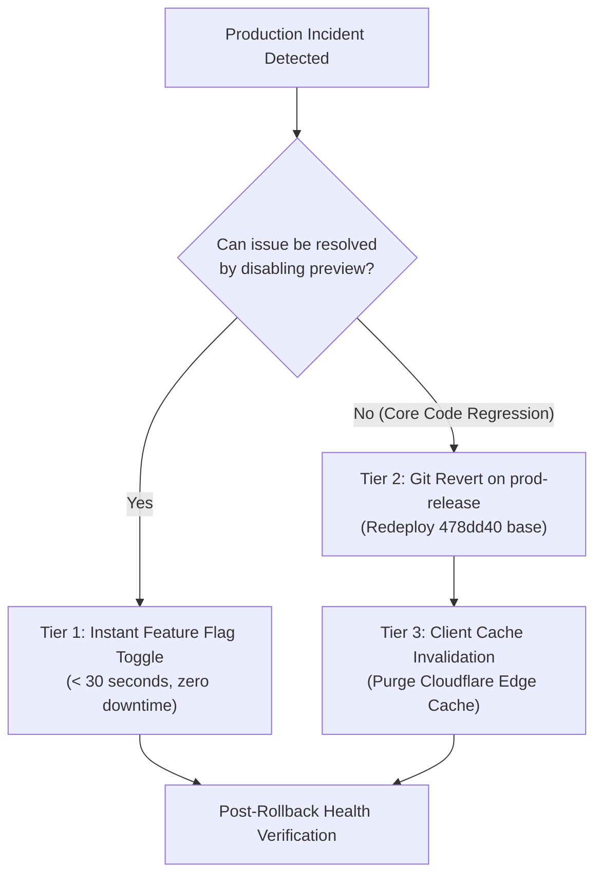

# AIRA Adaptive Studio: Exact-SHA Integration & Rollback Runbook

**Document Version:** 1.0.0  
**Target Environment:** `prod-release`  
**Known-Good Production Base SHA:** [`478dd40d4000216c386d32e89422f2e5da1d0208`](https://github.com/rajpunkeshwarrajgautam-boop/AIRA-AI-2026/commit/478dd40d4000216c386d32e89422f2e5da1d0208)  
**Certified Integration Candidate SHA:** [`2f48e583c48529f7cf7eb4cb4be5cb0a22a362e6`](https://github.com/rajpunkeshwarrajgautam-boop/AIRA-AI-2026/commit/2f48e583c48529f7cf7eb4cb4be5cb0a22a362e6)  

---

## 1. Overview & Operational Principles

This runbook defines the concrete operational procedures for deploying the AIRA Adaptive Studio integration candidate to `prod-release` and executing an **instant, zero-downtime rollback** in the event of an unexpected regression.

### Core Safety Guarantee
Because Adaptive Studio is guarded by the opt-in feature flag `VITE_ADAPTIVE_STUDIO_PREVIEW`, deploying the code changes introduces **zero modifications to the default baseline experience**. The primary rollback mechanism requires zero code deployment and executes in seconds.

---

## 2. Pre-Integration Verification & SHA Record

Before initiating the merge into `prod-release`, verify that the candidate matches the exact certified SHA record:

```powershell
# 1. Fetch latest upstream
git fetch origin prod-release

# 2. Confirm base SHA is exactly 478dd40d4000216c386d32e89422f2e5da1d0208
git rev-parse origin/prod-release
# Output MUST be: 478dd40d4000216c386d32e89422f2e5da1d0208

# 3. Confirm candidate SHA is exactly 2f48e583c48529f7cf7eb4cb4be5cb0a22a362e6
git rev-parse design/adaptive-studio-phase1
# Output MUST be: 2f48e583c48529f7cf7eb4cb4be5cb0a22a362e6

# 4. Verify clean linear merge base
git merge-base design/adaptive-studio-phase1 origin/prod-release
# Output MUST be: 478dd40d4000216c386d32e89422f2e5da1d0208
```

---

## 3. Tiered Rollback Protocols



### Tier 1: Instant Feature Flag Rollback (Preferred)
* **When to use:** Any UI bug, console exception, responsive layout distortion, or unexpected behavior in Adaptive Studio.
* **Recovery Time Objective (RTO):** < 30 seconds.
* **Impact:** 0 downtime. Baseline AIRA interface continues running undisturbed.

**Procedure:**
1. In Cloudflare Pages / Workers or hosting environment, set:
   ```bash
   VITE_ADAPTIVE_STUDIO_PREVIEW="false"
   ```
2. Trigger rapid redeployment / configuration reload.
3. Validate client browser response:
   - Request `GET /` -> Confirm `.aira-adaptive-shell` is completely absent from DOM.
   - Confirm standard AIRA Chat and Agent interfaces render with 100% fidelity.

---

### Tier 2: Atomic Git Revert on `prod-release`
* **When to use:** Regressions affecting baseline code paths that persist even when the feature flag is disabled.
* **Recovery Time Objective (RTO):** 2–5 minutes (standard CI build time).

**Procedure:**
1. Check out `prod-release`:
   ```powershell
   git checkout prod-release
   git pull origin prod-release
   ```
2. Identify the merge commit SHA (`<MERGE_SHA>`).
3. Revert the merge commit cleanly:
   ```powershell
   git revert -m 1 <MERGE_SHA> -m "revert: rollback Adaptive Studio integration candidate to 478dd40"
   ```
4. Run regression checks:
   ```powershell
   npm run typecheck:client
   npm run build
   ```
5. Push to `prod-release`:
   ```powershell
   git push origin prod-release
   ```

**Alternative Emergency Fallback (Direct Redeploy of Base SHA):**
If Git revert is blocked or delayed, redeploy the known-good base SHA directly from CI:
```powershell
git checkout 478dd40d4000216c386d32e89422f2e5da1d0208
# Deploy exact known-good commit to production target
```

---

### Tier 3: Client Cache Invalidation & Session Cleanup
* **When to use:** Following Tier 1 or Tier 2 rollback to guarantee no stale JavaScript bundles or cached artifacts remain in client browsers.

**Procedure:**
1. **Purge Cloudflare Cache:**
   - Execute Cloudflare Purge All Cache for `aira.internal` / production domain.
2. **Purge Service Worker / Local Storage Caches:**
   - Bump cache bust query string in deployment manifest (`?v=prod-base-478dd40`).
   - Browser sessions will invalidate local caches upon next reload.

---

## 4. Post-Rollback Verification & Smoke Testing Checklist

Following any rollback execution, confirm the following verification gates before concluding the incident:

- [ ] `GET https://aira.app/` returns HTTP 200 with standard baseline headers.
- [ ] Account menu opens and closes without stacking issues (verifying `#126` fix is intact).
- [ ] Baseline chat message submission, token streaming, and history restoration function normally.
- [ ] Zero unhandled JavaScript exceptions in browser console.
- [ ] Port listeners on production edge nodes report 100% healthy status.
- [ ] Post-incident report logged in `docs/postmortems/`.
