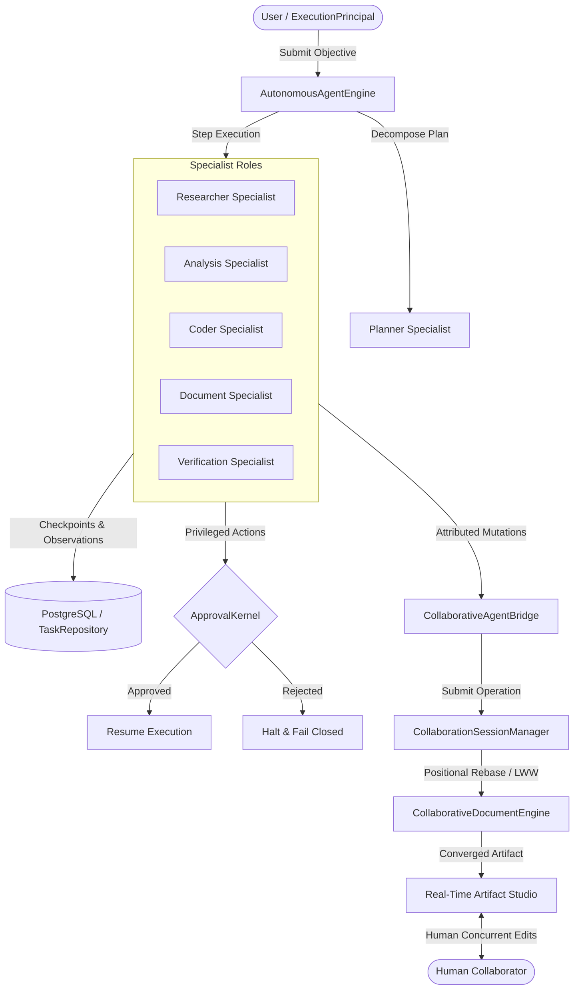

# AIRA GenUI Phase 5B — Autonomous Intelligence & Swarm Collaboration Specification

**Document Version:** `1.0.0`  
**Status:** SPECIFIED  
**Date:** 2026-11-28  
**Worktree:** `C:\Users\WORKSTATION\AIRA-AI-2026-GENUI`  
**Branch:** `feat/aira-genui-phase1-foundation`  
**Primary Coordinator:** Agency Agents Orchestrator  
**Technical Lead:** Multi-Agent Systems Architect & Software Architect  
**Applicable Protocols:** `aira-collab/v1`, `aira-artifact/v1`, `AutonomousAgentTaskSchema`, `SpecialistTaskContract`  

---

## 1. Problem Statement & Scope

AIRA AI 2026 possesses a mature native durable specialist execution runtime (`packages/agent-runtime/src/durable/`) and an autonomous task engine (`packages/agent-runtime/src/autonomous/autonomous-engine.ts`) supporting hierarchical task decomposition, specialist assignment (Planner, Researcher, Coder, Document Specialist, Verifier), fencing tokens, and approval gating. Concurrently, Phase 4C established the real-time collaborative workspace (`aira-collab/v1` and `src/utils/collaborationEngine.ts`).

However, the autonomous runtime and the collaborative workspace operated in architectural silos:
1. Autonomous agents lacked a direct bridge to submit sequenced operations (`text_insert`, `cell_update`, `slide_mutate`, `diagram_mutate`) to collaborative artifact rooms.
2. Agent edits required authoritative attribution (`isAgent: true`, `agentRole`, `runId`, `taskId`) and tenant isolation enforcement on the server boundary.
3. Long-horizon missions needed to preserve concurrent human edits without silent overwrites, surface spreadsheet same-cell collisions, and recover durably from worker crashes using PostgreSQL checkpoints.

Phase 5B defines the unified **Autonomous Intelligence & Swarm Collaboration Architecture**, bridging `AutonomousAgentEngine` to `CollaborationSessionManager` via `CollaborativeAgentBridge`.

---

## 2. Multi-Agent Systems Topology & Governance



### 2.1 Topology Selection: Hierarchical Orchestrator-Subagent
- Peer/mesh networks are strictly avoided to eliminate consensus deadlocks and unbounded token explosion.
- The `AutonomousAgentEngine` acts as the single hierarchical coordinator, decomposing objectives into validated Directed Acyclic Graphs (DAGs) and dispatching bounded specialist workers.
- Each specialist agent receives a bounded context: role prompt, objective summary, and relevant prior observations, preventing context budget exhaustion.

---

## 3. Core Specification Contracts

### 3.1 Agent CollabActor Attribution
Every mutation submitted by an autonomous agent must carry authoritative identity:
```typescript
export interface CollabActor {
  actorId: string;       // e.g. "agent_researcher_step_research"
  principalId: string;   // Bound to user ExecutionPrincipal.userId
  displayName: string;   // e.g. "Researcher Specialist"
  role: "editor";
  isAgent: true;         // Identifies non-human agent
  agentRole: string;     // Specialist role identifier
  runId: string;         // Autonomous task ID
  taskId: string;        // Plan step ID
  color: string;         // Visual presence color
}
```

### 3.2 Collaborative Agent Bridge (`CollaborativeAgentBridge`)
- **Location:** `packages/agent-runtime/src/collaborative-bridge.ts`
- **Responsibilities:**
  1. `createAgentActor(task, stepId, role, displayName)`: Formulates immutable agent identity.
  2. `getOrCreateSession(sessionId, initialArtifact, task)`: Enforces tenant isolation matching `task.principal.workspaceId`.
  3. `submitAgentOperation(sessionId, actor, opType, payload, task)`: Sequenced mutation via `CollaborationSessionManager`.
  4. `syncArtifactToTask(sessionId, task)`: Reflects convergent artifact state into `task.artifacts`.
  5. `coAuthorMultiAgent(sessionId, operations, task)`: Coordinates concurrent multi-specialist authoring.

### 3.3 Durable Task Checkpoints & Fencing Tokens
- Every task state transition increments `fencingToken: number`.
- If a worker loses its lease or crashes, a competing or resuming worker claims the task with an incremented fencing token. Stale workers attempting to commit updates are rejected with `STALE_FENCING_TOKEN`.
- Completed inference outputs and tool results are checkpointed to `task.observations` and `task.workingMemory`. A resumed task skips already completed steps without re-running expensive model calls.

### 3.4 ApprovalKernel Human-in-the-Loop Gating
- Steps with `sideEffectLevel: 'WRITE'` or `'DESTRUCTIVE'` pause execution:
  - Task transitions to `WAITING_FOR_APPROVAL`.
  - Event `task.approval_requested` is emitted with `approvalRequestId`.
  - Specialist agents cannot approve their own actions.
  - Upon user approval (`approveStep`), task transitions atomically through `RESUMING -> RUNNING` and executes the gated action. Rejection transitions to `FAILED`.

---

## 4. Acceptance Criteria & Test Scenarios (Missions A–M)

1. **Mission A (Multi-specialist Research Report):** Decomposes objective into research, synthesis, artifact creation, and verification.
2. **Mission B (Data Analysis & Spreadsheet):** Ingests dataset, updates cell values, evaluates formulas reactively via AST.
3. **Mission C (Multi-Artifact Consistency):** Generates document, spreadsheet, and presentation from shared data.
4. **Mission D (Code Development Task):** Produces bounded multi-file bundle with zero filesystem escape.
5. **Mission E (Concurrent Multi-Agent Co-Authoring):** Researcher and Copywriter agents concurrently mutate document; edits interleave cleanly.
6. **Mission F (Human-Agent Concurrent Editing):** Human edits are preserved during concurrent AI patch application via positional rebase.
7. **Mission G (Interrupted Mission Recovery):** Worker terminates mid-pipeline; resuming worker restarts from checkpoint without re-running completed steps.
8. **Mission H (Provider Failure & Safe Fallback):** Retries within limits and handles provider errors gracefully.
9. **Mission I (Approval Pause):** Privileged write step pauses execution until explicit user approval token is provided.
10. **Mission J (Cancellation Propagation):** Cancelling mission aborts active executions and sets `CANCELLED`.
11. **Mission K (Tenant Isolation):** Foreign tenant cannot read, claim, or mutate missions or collaborative sessions.
12. **Mission L (Resource Budget Exhaustion):** Task exceeding `maxExecutionCycles` terminates safely with `LOOP_LIMIT_EXCEEDED`.
13. **Mission M (Final Evidence-Backed Verification):** Verification specialist audits final deliverables before `COMPLETED` state transition.
