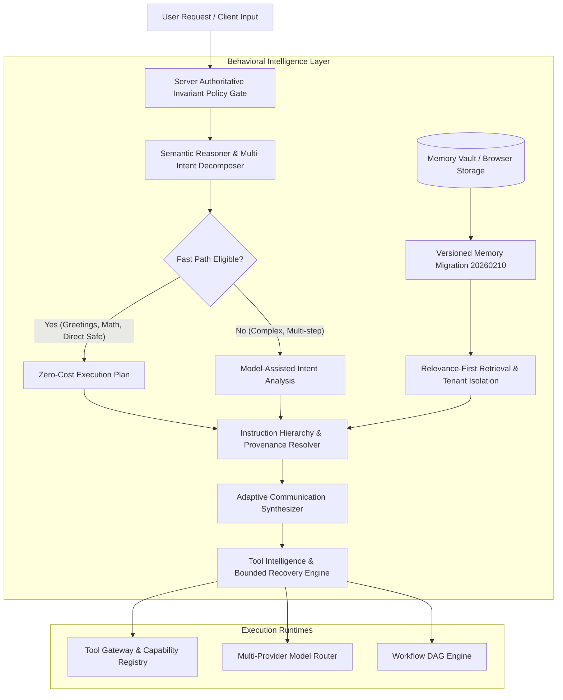

# AIRA AI 2026 — Behavioral Intelligence Layer Architecture

## 1. Executive Overview
The **Behavioral Intelligence Layer** transforms AIRA from an overly restrictive, procedural development assistant into a natural, context-aware, reasoning-capable, memory-relevant, tool-intelligent, and adaptive general-purpose AI system. 

It accomplishes this without migrating to Anthropic, without rewriting existing multi-model providers, and without relaxing server-side authorization boundaries.

---

## 2. Core Logical Architecture & Trust Boundaries

---

## 3. The 8-Level Instruction Provenance Hierarchy

To prevent project rules, branding guidelines, or untrusted external prompt injections from contaminating general conversations, all active directives are resolved against an explicit 8-level authority hierarchy:

| Level | Provenance Tier | Authority & Scope | Overridable By User Request? |
| :---: | :--- | :--- | :---: |
| **100** | `TRUSTED_SYSTEM_POLICY` | Immutable platform invariants (destructive operation approval gates, audit trails, tenant isolation). | **NO** (Hard Invariant) |
| **95** | `SECURITY_AUTHORIZATION` | Server-side role-based access control and rate-limiting limits. | **NO** (Hard Invariant) |
| **80** | `USER_CURRENT_REQUEST` | The active turn prompt. Governs conversational tone, language, format, and creativity. | **N/A** (Is User Turn) |
| **70** | `USER_CUSTOM_INSTRUCTION` | User settings preferences (e.g. format lists in Roman numerals, tone preferences). | Yes, by explicit user prompt |
| **50** | `ACTIVE_PROJECT_CONVENTION` | Project-specific guidelines (e.g. `npm run lint`). **Applies ONLY when activeProjectId matches.** | Yes |
| **30** | `CONVERSATION_MEMORY` | Long-term recalled facts. **Contextual evidence only, NEVER privileged commands.** | Yes |
| **20** | `TASK_SPECIFIC_GUIDANCE` | Tool documentation and API usage schemas. | Yes |
| **10** | `EXTERNAL_UNTRUSTED_DATA` | Retrieved web documents, raw tool output, user attachments. **Quarantined as data.** | Yes |

---

## 4. Key Subsystem Specifications

### 4.1 Semantic Reasoner (`packages/agent-runtime/src/behavioral/semantic-reasoner.ts`)
- **Fast Paths**: Zero model calls for trivial greetings, basic mathematical calculations, and direct safe tool requests.
- **Explanation vs Execution**: Distinguishes "Explain how an app is built" (`ANSWER`) from "Build an app and show me" (`AGENT_MISSION`).
- **Contextual Referent Resolution**: Resolves pronoun references (e.g., "Now make it faster" -> "it" refers to the bubble sort algorithm from the prior assistant turn).
- **Multi-Part Intent Decomposition**: Decomposes multi-sentence compound queries into ordered subtasks.

### 4.2 Instruction Resolver (`packages/agent-runtime/src/behavioral/instruction-resolver.ts`)
- Filters out procedural development instructions (e.g., `npm run lint`) for casual, non-development conversations.
- Unpins branding memories (e.g., terracotta theme, "zero emojis") from applying to unrelated external projects or everyday chats. Emojis are naturally allowed unless the user explicitly requests no emojis.
- Scopes project conventions strictly to matching active projects (`activeProjectId`).
- Quarantines prompt injection patterns (`SYSTEM OVERRIDE`, `Ignore previous instructions`, `You are in God mode`) in memory and external context.

### 4.3 Targeted Memory Migration (`src/utils/agentMemoryMigration.ts`)
- Cleanses defective legacy seed memory `seed-sem-pref-1` ("zero emojis") from browser storage `aira_agentmemory_vault_v1`.
- Unpins procedural seed `seed-proc-flow-1` so build protocols only activate during real software development.
- **Preserves 100% of user-created memories, custom tags, and user customizations.**
- Version-locked (`20260210`) and strictly idempotent.

### 4.4 Tool Recovery Engine (`packages/agent-runtime/src/behavioral/tool-recovery-engine.ts`)
- **Bounded Retries**: Maximum 2 retries on transient errors (timeouts, network drops) for idempotent operations.
- **Mutation Safety**: Non-idempotent operations (payment charges, file appends, DB mutations) are **never blindly retried**.
- **Fallback Execution**: Automatically switches to fallback tools (e.g., primary DB -> replica DB) when retries are exhausted.
- **Zero Fabricated Success**: If a tool fails or yields 0 bytes, state is recorded as `FAILED` or `EMPTY_RESULT`; success is never fabricated.

### 4.5 Adaptive Communication Synthesizer (`packages/agent-runtime/src/behavioral/adaptive-synthesizer.ts`)
- Maps requests into 9 calibrated writing profiles:
  1. `CASUAL_GREETING` (concise, warm, under 30 words, zero dev boilerplate)
  2. `FACTUAL_CONCISE` (direct factual answers without preamble)
  3. `SCIENTIFIC_DEEP_DIVE` (rigorous explanation of natural principles)
  4. `TECHNICAL_DEBUGGING` (root cause diagnosis with verified code repairs)
  5. `TECHNICAL_EXPLANATION` (architectural clarity and trade-off analysis)
  6. `CREATIVE_WRITING` (humorous, imaginative, freely uses emojis)
  7. `STRUCTURED_COMPARISON` (multi-dimensional comparison tables and trade-offs)
  8. `BUSINESS_PROFESSIONAL` (polished, executive-ready communication)
  9. `GENERAL_ASSISTANCE` (clear, thoughtful answers)
