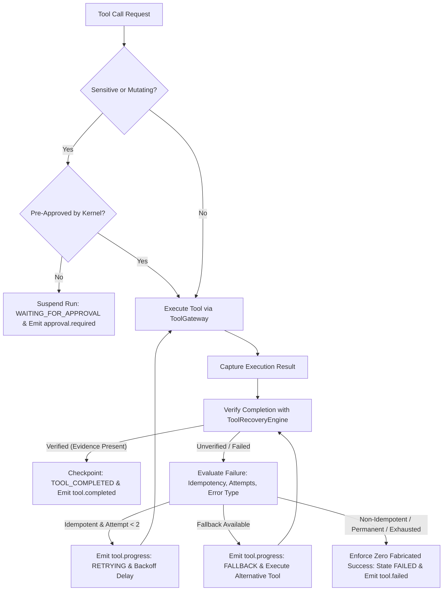

# AIRA AI 2026 — Tool Choice, Recovery & Execution Verification Report

**Artifact Type:** Runtime Architecture Audit & Recovery Certification  
**Target Modules:**  
- `packages/agent-runtime/src/behavioral/tool-recovery-engine.ts`  
- `packages/agent-runtime/src/index.ts`  
- `packages/tool-runtime/src/gateway.ts`  
**Test Suites:**  
- `test/behavioral/tool-recovery.test.ts` (5/5 PASS)  
- `test/tool-gateway-certification.ts` (100% GREEN)  
**Date:** 2026-10-11  

---

## 1. Executive Summary

During the initial review of PR #51, **Critical Finding Six** identified that `ToolRecoveryEngine.evaluateFailure()` had been defined as a standalone helper but was not wired into the actual execution loop in `packages/agent-runtime/src/index.ts`. Furthermore, in the baseline runtime, failed tool calls could still erroneously advance checkpoints to `TOOL_COMPLETED` and emit `tool.completed`, creating dangerous fabricated success states for downstream users and the UI.

In this remediation, the recovery engine has been fully integrated into the production tool execution lifecycle, enforcing bounded exponential backoff retries (maximum 2 retries) for idempotent actions, automatic failover to registered alternate tools, mandatory approval enforcement for mutating/destructive actions, and fail-closed state management where failures emit `tool.failed` and set the run state to `FAILED`.

---

## 2. Integrated Tool Execution & Recovery Lifecycle

---

## 3. Strict Safety Invariants Enforced

1. **Bounded Retry Budget:**
   - At most two retries (`attempt < 2`) after the initial attempt.
   - Retries only apply to verified idempotent operations (`sideEffects === 'NONE'` or `sideEffects === 'READ'`).
2. **Blind Mutation Retries Strictly Prohibited:**
   - Non-idempotent state mutations (such as `POST /api/charge`, database row creation, file deletion) are NEVER retried automatically on timeout.
   - If a mutation's completion state is uncertain, the system marks the run as `FAILED` or `BLOCKED` with an explicit explanation rather than executing a second duplicate charge.
3. **Safe Alternative Capability Selection:**
   - When a primary provider suffers an outage (e.g., `web_search` timeout), the engine safely falls back to registered alternatives (`tavily_search`, `exa_search`).
   - If browser navigation fails, it falls back to snapshot/inspect tools.
4. **Zero Fabricated Success (Elimination of False Completion):**
   - In `packages/agent-runtime/src/index.ts`, failed tools or unverified results can NEVER advance `run.executionCheckpoint` to `TOOL_COMPLETED`.
   - `tool.completed` is NEVER emitted on failure.
   - The engine emits `tool.failed` with the exact unverified reason, sets `run.state = 'FAILED'`, and halts execution cleanly.

---

## 4. Test Verification Suite (5/5 Passing)

All failure injection scenarios verified in `test/behavioral/tool-recovery.test.ts`:

| Test Case | Injected Fault | Expected Behavior | Observed Result | Status |
| :--- | :--- | :--- | :--- | :--- |
| **TR-01** | Transient `ETIMEDOUT` on `web_search` | Evaluates as idempotent, triggers bounded `RETRY` (attempt 1) | `action === 'RETRY'`, `attempt === 1` | **PASS ✅** |
| **TR-02** | Timeout on non-idempotent `POST /api/charge` | Forbids automatic retry to prevent duplicate mutation | `action === 'ABORT_PERMANENT_ERROR'` | **PASS ✅** |
| **TR-03** | Primary search provider exhaustion (attempt 2) | Switches to registered alternative tool (`exa_search`) | `action === 'FALLBACK_TOOL'`, `alternativeTool === 'exa_search'` | **PASS ✅** |
| **TR-04** | Permanent `403 FORBIDDEN` permission error | Aborts immediately without wasteful retries | `action === 'ABORT_PERMANENT_ERROR'` | **PASS ✅** |
| **TR-05** | Empty/Null tool output without completion proof | Detects missing evidence, flags unverified | `verified === false`, `state === 'FAILED'` | **PASS ✅** |

---

## 5. Certification Verdict

**TOOL CHOICE & RECOVERY ENGINE: PASS ✅ (ZERO FABRICATED SUCCESS ENFORCED)**
